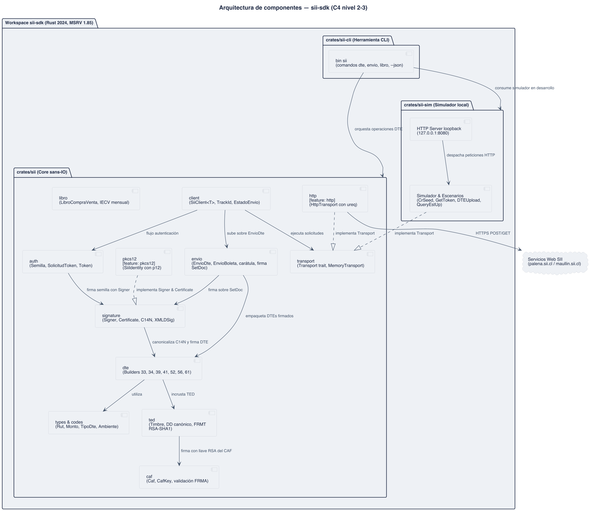
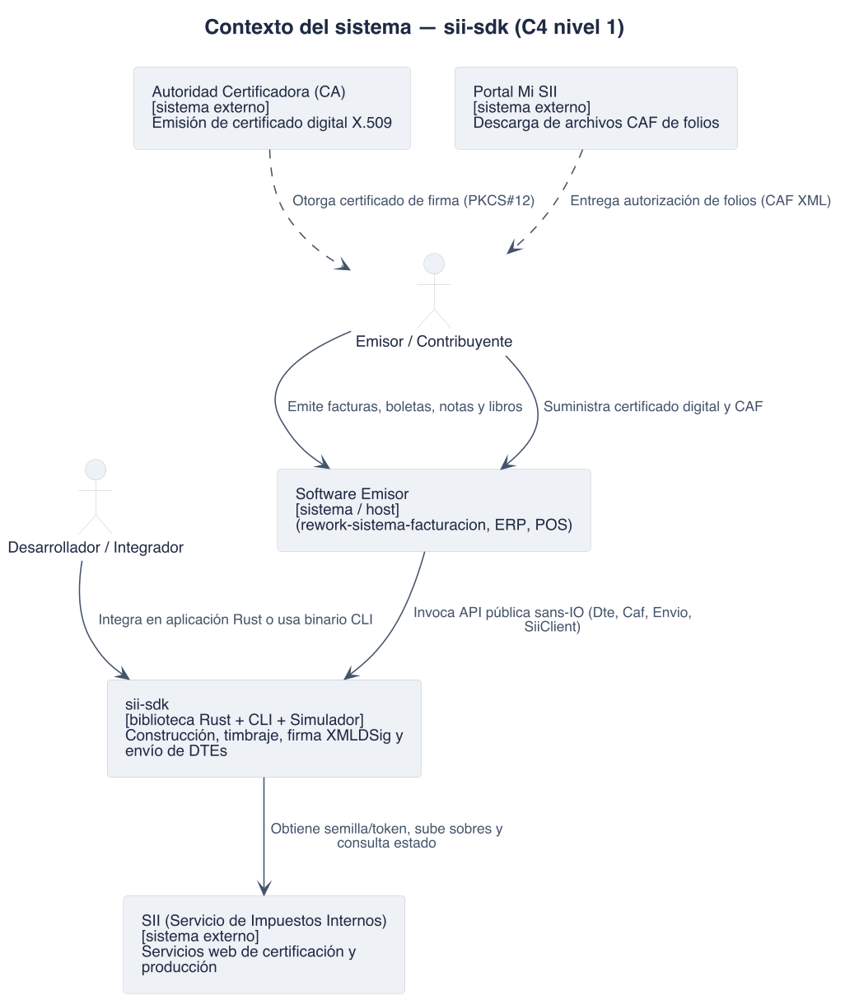

# sii-sdk

SDK **no oficial** en Rust para los Documentos Tributarios Electrónicos (DTE) del Servicio de Impuestos Internos (SII) de Chile: construcción, timbraje, firma digital XMLDSig, carátulas y sobres de envío, consulta de estado y libros de compra/venta, con un **simulador local** de endpoints y una **CLI**.

> ⚠️ **Proyecto no oficial.** No está afiliado, respaldado ni mantenido por el Servicio de Impuestos Internos (SII). Se implementa de forma independiente a partir de la documentación técnica y resoluciones públicas del SII (ver [`docs/md/dte-spec.md`](docs/md/dte-spec.md) y [`NOTICE`](NOTICE)). Úsalo bajo tu responsabilidad y realiza el proceso de certificación tributaria formal antes de operar en producción.

---

## 1. Qué es y para quién

`sii-sdk` es una biblioteca y conjunto de herramientas en Rust orientada a aplicaciones de facturación, ERPs, sistemas de punto de venta (POS) y servicios de back-office en Chile (como [`rework-sistema-facturacion`](https://github.com/Demiannnnnn/rework-sistema-facturacion)).

Está concebido para desarrolladores y empresas que necesitan:
- Emitir y procesar documentos tributarios chilenos con **fidelidad byte a byte** según los esquemas oficiales del SII (`DTE_v10.xsd`, `EnvioDTE_v10.xsd`, `LibroCV_v10.xsd`).
- Una arquitectura **sans-IO determinista**: el núcleo no realiza E/S de red ni disco, permitiendo probar toda la lógica de negocio y validación tributaria sin tocar el ambiente del SII ni depender de archivos locales.
- **Criptografía inyectada**: traits desacoplados para firma digital y certificados X.509, compatible con módulos PKCS#12, HSM o cargadores de prueba autogenerados.
- **Simulación local completa**: desarrollo ágil sin consumir folios reales ni certificados de producción gracias al simulador `sii-sim`.

---

## 2. Características principales

- **Modelo DTE sans-IO:**
  - Factura Electrónica Afecta (Tipo 33) con cálculo automático de IVA 19% sobre monto neto.
  - Factura Electrónica Exenta (Tipo 34) y Boleta Exenta (Tipo 41) sin recargo de IVA.
  - Boleta Electrónica de Ventas y Servicios (Tipo 39).
  - Guía de Despacho Electrónica (Tipo 52).
  - Nota de Débito (Tipo 56) y Nota de Crédito (Tipo 61) con validación estricta de referencias obligatorias.
- **Manejo y Validación de CAF:**
  - Parseo de archivos XML de Código de Autorización de Folios (`<AUTORIZACION>`).
  - Verificación de límites de rango `[Desde..Hasta]` y pertenencia de folios.
  - Validación de la firma digital `FRMA` del SII contra la llave pública oficial.
- **Timbre Electrónico DTE (TED):**
  - Generación del bloque canónico `<DD>` conforme a las especificaciones del SII.
  - Firma digital `FRMT` mediante **RSA-SHA1** utilizando la llave privada del CAF (requerimiento técnico del SII).
  - Formato canónico para su codificación directa en código de barras bidimensional PDF417.
- **Firma Digital XMLDSig:**
  - Canonicalización C14N determinista y firma enveloped sobre nodos `<Documento>`, `<SetDoc>` y `<getToken>`.
  - Inserción de certificados X.509 (`<KeyInfo>`) y validación de firmas recibidas.
- **Sobres de Envío y Libros:**
  - Empaquetado en sobres `EnvioDTE` y `EnvioBOLETA` con carátula de control y resumen de subtotales.
  - Libro de Compra y Venta (IECV) con carátula y resúmenes de período mensual.
- **Cliente y Autenticación:**
  - Flujo completo de autenticación: obtención de semilla (`CrSeed.jws`) y canje por token firmado (`GetTokenFromSeed.jws`).
  - Envío multipart/form-data a `DTEUpload` con recepción de Track ID.
  - Consulta de estado asíncrono vía SOAP (`QueryEstUp.jws`) con desescapado automático y clasificación de estados.
- **Tratamiento de Rechazos (ADR-04):**
  - Los rechazos de sobres o documentos por el SII (`EstadoEnvio::Rechazado`) se manejan como valores de dominio, reservando `Result::Err` exclusivamente para fallos de red o datos corruptos.
- **Simulador Local (`sii-sim`):**
  - Servidor loopback (`127.0.0.1:8080`) que reproduce fielmente los servicios del SII con escenarios preconfigurados (`aceptado`, `rechazado`, `en_proceso`, `token_invalido`, `upload_rechazado`, `semilla_error`).
- **Herramienta CLI (`sii`):**
  - Operaciones completas desde terminal para timbrar, firmar, empaquetar, enviar y consultar estado en modo interactivo o con salida `--json` estructurada.

---

## 3. Estado del proyecto

El SDK cuenta con **140+ pruebas automatizadas** en verde (unitarias, integración, property testing con `proptest`, doc-tests y pruebas de humo).

| Tarea | Módulo / Componente | Estado |
|:--|:--|:--|
| **INFRA-01** | Workspace Cargo, lints estrictos, CI con GitHub Actions | ✅ Completada |
| **CORE-01** | Tipos base: `Rut` (módulo 11), `Monto` (i64 sin f64), `TipoDte`, `Ambiente` | ✅ Completada |
| **CAF-01** | Parseo y validación de CAF, rango de folios, llave RSA y verificación FRMA | ✅ Completada |
| **DTE-01** | Modelo DTE sans-IO y serialización XML para tipos 33 y 34 | ✅ Completada |
| **DTE-02** | Soporte para boletas (39/41), guía (52) y notas de crédito/débito (56/61) | ✅ Completada |
| **TED-01** | Timbre Electrónico DTE (TED), bloque DD, firma RSA-SHA1 y datos PDF417 | ✅ Completada |
| **SIG-01** | Firma digital XMLDSig, canonicalización C14N y verificación | ✅ Completada |
| **ENVIO-01** | Sobres de envío `EnvioDTE` y `EnvioBOLETA`, carátula y firma de lote | ✅ Completada |
| **AUTH-01** | Autenticación ante el SII: modelo de semilla y firma de token | ✅ Completada |
| **TRANSPORT-01**| Trait `Transport`, `MemoryTransport` y `HttpTransport` (feature `http` con `ureq`) | ✅ Completada |
| **CERT-LOADER-01**| Cargador de certificados digitales PKCS#12/PEM (feature `pkcs12`) | ✅ Completada |
| **LIBRO-01** | Libro de compra y venta electrónico (IECV) | ✅ Completada |
| **SIM-01** | Simulador de servicios y endpoints del SII (`sii-sim`) | ✅ Completada |
| **CLI-01** | Herramienta de línea de comandos (`sii-cli` / binario `sii`) | ✅ Completada |
| **DOCS-01** | Preparación de publicación en crates.io y CHANGELOG | ⬜ En cola |
| **HDOC-01** | Estructura de documentación para humanos, diagramas y README | ✅ Completada |
| **HDOC-02..04**| Informes técnicos, legales, de seguridad y pruebas | ⬜ En cola |
| **CERT-99** | Certificación contra ambiente Maullín del SII (manual, realizada por el dueño) | ⬜ Planificada |

---

## 4. Arquitectura

### Arquitectura de Componentes


### Contexto del Sistema (C4 Nivel 1)


---

## 5. Stack tecnológico

El stack está **cerrado** y sujeto a las directrices de [`architecture.md`](.ai-context/architecture.md):

| Componente | Tecnología / Crate | Versión | Propósito |
|:--|:--|:--|:--|
| **Lenguaje** | Rust (Edición 2024) | MSRV 1.85 | Núcleo, simulador y CLI |
| **Parser / Serializador XML** | `quick-xml` | 0.37 | Lectura y escritura de XML tributario |
| **Criptografía RSA** | `rsa` | 0.9 | Timbre TED y firmas XMLDSig |
| **Funciones Hash** | `sha1`, `sha2` | 0.10 | SHA-1 (exigido por SII) y SHA-256 |
| **Certificados X.509** | `x509-cert`, `der`, `pkcs8` | 0.2, 0.7, 0.10 | Modelado y canonicalización DER |
| **Formatos Cripto** | `p12` | 0.6.3 | Carga de certificados PKCS#12 (`.pfx`, `.p12`) |
| **Codificación** | `base64` | 0.22 | Transmisión de firmas y certificados en XML |
| **Gestión de Errores** | `thiserror` | 2.0 | Jerarquía de errores tipados sin pánicos |
| **Serialización Auxiliar**| `serde`, `serde_json` | 1.0 | Salida estructurada de CLI y escenarios |
| **Manejo de Fechas** | `time` | 0.3 | Fechas y marcas temporales tributarias |
| **Cliente HTTP** | `ureq` (con `rustls`) | 2.10 | Transporte HTTP sin dependencias de OpenSSL del sistema |
| **Línea de Comandos** | `clap` | 4.0 | Argumentos y subcomandos de la CLI |
| **Property Testing** | `proptest` | 1.0 | Verificación formal de módulo 11, montos y rangos |

---

## 6. Requisitos de instalación

- **Entorno de Compilación:**
  - Rust estable ≥ 1.85 (con componentes `rustfmt` y `clippy`).
- **Herramientas de Documentación (opcionales, para recompilar diagramas e informes):**
  - `plantuml` (con OpenJDK y Graphviz `dot`).
  - `tectonic` (para compilar LaTeX a PDF).
  - `pandoc` (para generar versiones DOCX).
- **Para Operación Real:**
  - Certificado digital tributario de persona natural en formato PKCS#12 (`.p12` o `.pfx`).
  - Archivo CAF (`.xml`) descargado desde el portal Mi SII correspondiente a los folios autorizados.

> Para propósitos de pruebas y desarrollo, el SDK **no requiere certificados ni folios reales**, pues incluye generadores en memoria y fixtures de prueba sanitizados.

---

## 7. Instalación y arranque rápido

### 1. Clonar el repositorio y verificar calidad
```bash
git clone https://github.com/Demiannnnnn/sii-sdk.git
cd sii-sdk

# Ejecutar la suite completa de pruebas
cargo test --workspace --all-features

# Validar lints y formato
cargo clippy --workspace --all-targets --all-features -- -D warnings
cargo fmt --all --check
```

### 2. Ejecutar el Simulador Local del SII
En una terminal:
```bash
# Inicia el simulador en loopback en el puerto 8080 (escenario predeterminado: aceptado)
cargo run -p sii-sim -- --listen 127.0.0.1:8080
```

Para probar rechazos o errores del SII:
```bash
cargo run -p sii-sim -- --scenario rechazado
cargo run -p sii-sim -- --scenario token_invalido
```

### 3. Usar la CLI (`sii`)
En otra terminal:
```bash
# Inspeccionar comandos disponibles
cargo run -p sii-cli -- --help

# Ver subcomandos de DTE
cargo run -p sii-cli -- dte --help
```

---

## 8. Configuración

| Variable de Entorno | Descripción | Obligatoria |
|:--|:--|:--|
| `SII_CERT_PASSWORD` | Contraseña para descifrar el certificado digital PKCS#12. | Solo para comandos de firma en CLI |
| `PLANTUML` | Ruta al ejecutable de PlantUML (por defecto busca en `$PATH` o `/Users/demian/Documents/Github/_sii/orch/bin/plantuml`). | Solo para `docs/build-docs.sh` |

---

## 9. Ejemplos de uso

### Creación, Timbraje y Firma de una Factura Electrónica (Tipo 33)

```rust
use sii::codes::TipoDte;
use sii::dte::{Detalle, Emisor, FacturaAfectaBuilder, Receptor};
use sii::types::{Monto, Rut};
use sii::caf::Caf;
use sii::signature::Signer;

fn emitir_factura(caf_xml: &[u8], cert_signer: &dyn Signer) -> Result<Vec<u8>, Box<dyn std::error::Error>> {
    let emisor_rut = Rut::parse("76.086.428-5")?;
    let receptor_rut = Rut::parse("12.345.678-5")?;

    // 1. Construir el DTE con validación de montos
    let dte = FacturaAfectaBuilder::new()
        .folio(101)
        .fch_emis_str("2026-11-22")?
        .emisor(Emisor {
            rut_emisor: emisor_rut,
            rzn_soc: "Empresa de Servicios SpA".into(),
            giro_emis: "Servicios Informáticos".into(),
            acteco: vec![620100],
            cdg_sii_sucur: None,
            dir_origen: "Av. Providencia 1234".into(),
            cmna_origen: "Providencia".into(),
            ciudad_origen: Some("Santiago".into()),
        })
        .receptor(Receptor::minimo(receptor_rut, "Cliente Corporativo S.A."))
        .item(
            Detalle::new(1, "Consultoría de Software", Monto::from_pesos(100_000))
                .qty(1)
                .prc(Monto::from_pesos(100_000)),
        )
        .build()?;

    // Validación automática: Neto $100.000 + 19% IVA ($19.000) = Total $119.000
    assert_eq!(dte.total(), Monto::from_pesos(119_000));

    // 2. Parsear el CAF y timbrar (agrega el nodo <TED> y datos para código PDF417)
    let caf = Caf::parse(caf_xml)?;
    let clock = sii::ted::SystemClock;
    let dte_timbrado = dte.timbrar(&caf, 101, &clock)?;

    // 3. Firmar digitalmente con XMLDSig enveloped
    let dte_firmado = dte_timbrado.firmar(cert_signer)?;

    Ok(dte_firmado.as_bytes().to_vec())
}
```

### Envío y Consulta de Estado con `SiiClient`

```rust
use sii::client::{EstadoEnvio, SiiClient, TrackId};
use sii::codes::Ambiente;
use sii::transport::HttpTransport;
use sii::signature::Signer;

fn enviar_al_sii(
    envio_xml: &[u8],
    signer: &dyn Signer,
) -> Result<(), Box<dyn std::error::Error>> {
    let transport = HttpTransport::new();
    let client = SiiClient::new(Ambiente::Certificacion, transport);

    // 1. Obtener Token de autenticación (solicita semilla y la firma)
    let token = client.obtener_token(signer)?;

    // 2. Subir sobre de envío
    let track_id = client.enviar(envio_xml, &token)?;
    println!("Envío aceptado por el SII. Track ID asignado: {}", track_id);

    // 3. Consultar estado asíncrono
    let estado = client.estado(&track_id, &token)?;
    match estado {
        EstadoEnvio::Aceptado(detalle) => {
            println!("Sobre aceptado por el SII: {}", detalle.glosa);
        }
        EstadoEnvio::Rechazado(detalle) => {
            // ADR-04: El rechazo es un valor de dominio
            eprintln!("Sobre rechazado por el SII: {}", detalle.glosa);
        }
        EstadoEnvio::EnProceso(detalle) => {
            println!("Sobre aún en procesamiento por el SII: {}", detalle.glosa);
        }
    }

    Ok(())
}
```

---

## 10. API técnica y documentación Rust

`sii-sdk` es una biblioteca sans-IO y no expone endpoints REST propios. Para consultar la documentación de los módulos y estructuras públicas:

```bash
# Genera y abre la documentación en tu navegador local
cargo doc --workspace --all-features --no-deps --open
```

Módulos principales de la biblioteca:
- [`sii::types`](crates/sii/src/types.rs): Tipos numéricos y de identificación (`Rut`, `Monto`, `compute_dv`).
- [`sii::codes`](crates/sii/src/codes.rs): Códigos normativos del SII (`TipoDte`, `Ambiente`).
- [`sii::caf`](crates/sii/src/caf.rs): Parseo de CAF y validación de firma `FRMA`.
- [`sii::dte`](crates/sii/src/dte.rs): Constructores tipados de DTE y reglas tributarias.
- [`sii::ted`](crates/sii/src/ted.rs): Timbre Electrónico DTE y codificación para PDF417.
- [`sii::signature`](crates/sii/src/signature.rs): Firma XMLDSig, canonicalización C14N y traits `Signer`/`Certificate`.
- [`sii::envio`](crates/sii/src/envio.rs): Sobres de envío de DTE y boletas.
- [`sii::libro`](crates/sii/src/libro.rs): Libros mensuales de compra y venta (IECV).
- [`sii::auth`](crates/sii/src/auth.rs): Semillas y tokens de autenticación del SII.
- [`sii::client`](crates/sii/src/client.rs): Orquestación de llamadas web y clasificación de estados.
- [`sii::transport`](crates/sii/src/transport.rs): Trait `Transport` y clientes HTTP.

---

## 11. Estrategia de pruebas

La suite de pruebas del proyecto no realiza conexiones de red externas ni utiliza certificados reales:

- **Pruebas Sans-IO:** Verificación determinista de serialización de XML contra fixtures oficiales del SII (ver [`tests/fixtures/`](crates/sii/tests/fixtures/)).
- **Property-based Testing (`proptest`):** Verificación exhaustiva de la validación del dígito verificador del RUT (módulo 11), consistencia aritmética del cálculo de IVA 19% sin desbordamientos y rangos de folios.
- **Pruebas de Verificación Criptográfica:** Validación de que una firma alterada o un nodo manipulado provoca un error estricto de verificación (SIG-02).
- **Pruebas contra el Simulador:** Escenarios de integración end-to-end simulando respuestas del SII en loopback.

Para ejecutar subconjuntos de pruebas:
```bash
cargo test -p sii --test dte_factura
cargo test -p sii --test signature
cargo test -p sii-sim --test simulator_tests
```

---

## 12. Estructura del repositorio

```
sii-sdk/
├── Cargo.toml                  # Configuración del workspace y lints globales
├── AGENTS.md                   # Reglas estrictas para agentes de IA
├── NOTICE                      # Atribución y avisos legales
├── LICENSE-MIT / LICENSE-APACHE# Licencias duales
├── README.md                   # Este archivo
├── .ai-context/                # Contexto técnico y directrices de diseño (solo lectura)
│   ├── architecture.md         # Principios de diseño y ADRs
│   ├── constraints.md          # Restricciones normativas con identificador (DTE-*, SEC-*, etc.)
│   ├── conventions.md          # Convenciones de estilo y código Rust
│   ├── domain.md               # Glosario y modelo de dominio tributario
│   ├── docs-standard.md        # Estándar de documentación técnica y diagramas
│   ├── handoff.md              # Estado de avance y pendientes
│   ├── implementation-status.md# Detalle de cobertura de código
│   ├── public-api.md           # Contrato de la API pública
│   └── security-model.md       # Modelo de seguridad y secretos
├── crates/
│   ├── sii/                    # Núcleo sans-IO: DTE, CAF, TED, XMLDSig, Envíos, Libros y Cliente
│   ├── sii-sim/                # Simulador local de servicios web del SII
│   └── sii-cli/                # Herramienta de línea de comandos (binario `sii`)
├── docs/                       # Documentación para humanos
│   ├── build-docs.sh           # Script de compilación de diagramas y documentos
│   ├── md/                     # Especificaciones normativas en Markdown
│   │   ├── dte-spec.md         # Especificación técnica oficial de DTEs y servicios SII
│   │   ├── simulator-spec.md   # Especificación del simulador local
│   │   └── release.md          # Procedimiento de publicación en crates.io
│   ├── plantilla/              # Clase LaTeX, estilos PlantUML y filtros Pandoc
│   ├── diagramas/
│   │   ├── fuentes/*.puml      # Diagramas PlantUML fuente
│   │   ├── svg/*.svg           # Diagramas generados en formato vectorial
│   │   └── png/*.png           # Diagramas generados en alta resolución
│   └── informes/               # Informes técnicos, legales y operativos
└── tasks/                      # Plan maestro y desglose de tareas
```

---

## 13. Documentación para humanos

Los informes técnicos, normativos y operativos se generan a partir de fuentes LaTeX y Markdown en formatos PDF y DOCX listos para consulta:

| Documento | Descripción | Formatos |
|:--|:--|:--|
| **Informe Técnico** | Resumen ejecutivo, arquitectura, stack detallado con versiones exactas, modelo de datos y configuración. | [PDF](docs/informes/informe-tecnico/informe-tecnico.pdf) · [DOCX](docs/informes/informe-tecnico/informe-tecnico.docx) *(HDOC-02)* |
| **Informe Legal** | Matriz de cumplimiento normativo chileno (DL 825, Ley 19.799, resoluciones del SII). | [PDF](docs/informes/informe-legal/informe-legal.pdf) · [DOCX](docs/informes/informe-legal/informe-legal.docx) *(HDOC-03)* |
| **Informe de Diagramas** | Explicación detallada a página completa de todos los diagramas de arquitectura y secuencia. | [PDF](docs/informes/informe-diagramas/informe-diagramas.pdf) · [DOCX](docs/informes/informe-diagramas/informe-diagramas.docx) *(HDOC-02)* |
| **Informe de Seguridad** | Modelo de amenazas (STRIDE), gestión de llaves criptográficas y auditoría. | [PDF](docs/informes/informe-seguridad/informe-seguridad.pdf) · [DOCX](docs/informes/informe-seguridad/informe-seguridad.docx) *(HDOC-03)* |
| **Guía de Integración** | Guía paso a paso para desarrolladores de ERPs y sistemas de punto de venta. | [PDF](docs/informes/guia-integracion/guia-integracion.pdf) · [DOCX](docs/informes/guia-integracion/guia-integracion.docx) *(HDOC-04)* |
| **Informe de Pruebas** | Estrategia de pruebas, pirámide de testing y resultados de verificación. | [PDF](docs/informes/informe-pruebas/informe-pruebas.pdf) · [DOCX](docs/informes/informe-pruebas/informe-pruebas.docx) *(HDOC-04)* |

---

## 14. Cumplimiento legal y normativo

Este SDK implementa las disposiciones técnicas dictadas por el Servicio de Impuestos Internos de Chile:
- **Decreto Ley N° 825 de 1974:** Ley sobre Impuesto a las Ventas y Servicios (cálculo de base imponible, tasa general de IVA 19%, y exenciones tributarias).
- **Ley N° 19.799 de 2002:** Sobre Documentos Electrónicos, Firma Electrónica y Servicios de Certificación.
- **Resolución Exenta SII N° 45 de 2003:** Normas y procedimientos técnicos para la emisión de DTEs y carátulas de envío.
- **Resolución Exenta SII N° 80 de 2014:** Obligatoriedad de emisión de facturas y notas en formato digital.
- **Resolución Exenta SII N° 74 de 2020:** Instrucciones sobre emisión de boletas electrónicas de ventas y servicios.

> **Aviso de Responsabilidad Legal:** La emisión de documentos tributarios ante el SII tiene efectos legales y fiscales vinculantes. Este software se entrega bajo licencias de código abierto sin garantías de ninguna especie. Antes de utilizarlo en operaciones comerciales reales, la empresa emisora debe completar satisfactoriamente el proceso de postulación y certificación técnica ante el SII.

---

## 15. Seguridad

- **Cero Secretos en Repositorio (SEC-01):** Queda estrictamente prohibido versionar llaves privadas reales, certificados PKCS#12 o archivos CAF de producción. Todos los tests utilizan llaves sintéticas generadas en runtime.
- **Redacción de Información Sensible (SEC-02):** Las estructuras que almacenan llaves criptográficas implementan `Debug` y `Display` personalizados que redactan el contenido de los secretos para prevenir filtraciones en registros o trazas.
- **Sin `unsafe` (SAFE-01):** Todo el workspace compila con `#![forbid(unsafe_code)]`.
- **Reporte de Vulnerabilidades:** Si detectas una falla de seguridad, repórtala de forma responsable a través de los canales de seguridad del ecosistema raysac.

---

## 16. Licencia

Este proyecto está licenciado bajo una doble licencia:
- **Licencia MIT** ([`LICENSE-MIT`](LICENSE-MIT))
- **Licencia Apache 2.0** ([`LICENSE-APACHE`](LICENSE-APACHE))

Puedes elegir cualquiera de las dos licencias a tu conveniencia.

---

## 17. Relación con el ecosistema raysac

`sii-sdk` forma parte de la suite de código para back-office de pequeñas y medianas empresas en Chile desarrollada dentro del ecosistema raysac:

```
                      ┌───────────────────────────┐
                      │   raysac-enterprise-web   │ (Hub de Operaciones)
                      └─────────────┬─────────────┘
                                    │
          ┌─────────────────────────┼─────────────────────────┐
          │                         │                         │
          ▼                         ▼                         ▼
┌──────────────────┐      ┌──────────────────┐      ┌──────────────────┐
│ rework-sistema-  │      │     sistema-     │      │   blindmetrics   │
│   facturacion    │      │  remuneraciones  │      │ (Asistencia R38) │
└─────────┬────────┘      └──────────────────┘      └──────────────────┘
          │
          ├─────────────────────────┐
          ▼                         ▼
┌──────────────────┐      ┌──────────────────┐
│     sii-sdk      │      │  transbank-SDK   │
│  (DTEs del SII)  │      │ (POS y Webpay)   │
└──────────────────┘      └──────────────────┘
```
