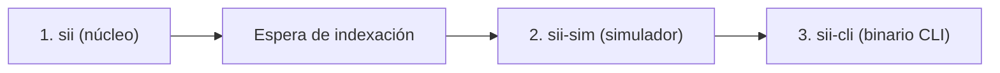

# Guía de Publicación y Release — sii-sdk

Este documento describe el procedimiento paso a paso para publicar y liberar nuevas versiones del SDK en [crates.io](https://crates.io).

> [!IMPORTANT]
> **Exclusivo para el dueño del repositorio.**
> Los agentes de IA tienen **estrictamente prohibido** ejecutar `cargo publish` (sin `--dry-run`), crear tags o empujar a `main`/`develop` (AGENTS.md §4, §7). Solo el dueño realiza la publicación manual.

---

## 1. Requisitos Previos

Antes de comenzar la publicación, asegúrate de:

1. **Sesión iniciada en crates.io:**
   ```bash
   cargo login
   ```
2. **Estar en la rama `main` limpia:**
   El código a publicar debe provenir de `main` tras la integración de `develop-AGENTS` en `develop` y de `develop` en `main`:
   ```bash
   git checkout main
   git pull origin main
   git status  # Debe estar completamente limpio
   ```
3. **Sin secretos en el repo:**
   Verificar que no existan credenciales o llaves reales:
   ```bash
   gitleaks protect --staged
   ```

---

## 2. Verificación de Calidad (DoD)

Ejecuta la suite completa de verificación desde la raíz del workspace:

```bash
# 1. Formato de código
cargo fmt --all --check

# 2. Lints con todas las features
cargo clippy --workspace --all-targets --all-features -- -D warnings

# 3. Lints del núcleo sans-IO puro
cargo clippy -p sii --no-default-features -- -D warnings

# 4. Todos los tests del workspace
cargo test --workspace --all-features

# 5. Documentación sin warnings ni enlaces rotos
RUSTDOCFLAGS="-D warnings" cargo doc --workspace --no-deps --all-features
```

Todos los comandos deben finalizar con código de salida `0` sin advertencias.

---

## 3. Preparación de la Versión

1. **Revisar versión en `Cargo.toml`:**
   En la sección `[workspace.package]` del `Cargo.toml` raíz, confirma o actualiza la versión (por ejemplo `0.1.0`):
   ```toml
   [workspace.package]
   version = "0.1.0"
   ```
   *Nota: Todos los crates del workspace heredan esta versión vía `version.workspace = true`.*

2. **Actualizar `CHANGELOG.md`:**
   Mover las entradas de `[Unreleased]` a la sección de la versión `[X.Y.Z] - YYYY-MM-DD` siguiendo la convención [Keep a Changelog](https://keepachangelog.com/).

3. **Verificar simulación del paquete principal:**
   ```bash
   cargo publish --dry-run -p sii
   ```

---

## 4. Orden Estricto de Publicación

Debido a que `sii-sim` y `sii-cli` dependen del crate núcleo `sii`, **el orden de publicación es mandatorio**:



Si intentas publicar `sii-sim` o `sii-cli` antes de que la versión de `sii` esté disponible e indexada en crates.io, `cargo publish` fallará indicando: `no matching package named sii found`.

### Paso 4.1: Publicar `sii` (Librería Núcleo)

```bash
cargo publish -p sii
```

Una vez subido, espera aproximadamente **1 a 2 minutos** para que el índice de crates.io se actualice. Puedes verificarlo con:

```bash
cargo search sii
```

### Paso 4.2: Publicar `sii-sim` (Simulador)

Una vez que `sii` esté disponible en crates.io:

```bash
# Simular empaquetado y verificación
cargo publish --dry-run -p sii-sim

# Publicar definitivamente
cargo publish -p sii-sim
```

Espera nuevamente ~1 minuto para su indexación.

### Paso 4.3: Publicar `sii-cli` (Línea de Comandos)

```bash
# Simular empaquetado y verificación
cargo publish --dry-run -p sii-cli

# Publicar definitivamente
cargo publish -p sii-cli
```

---

## 5. Tagging y Release en Git

Tras completar la publicación en crates.io:

1. **Crear tag anotado en Git:**
   ```bash
   git tag -a v0.1.0 -m "Release v0.1.0"
   git push origin v0.1.0
   ```

2. **Crear GitHub Release:**
   - Ve a `https://github.com/Demiannnnnn/sii-sdk/releases/new`.
   - Selecciona el tag `v0.1.0`.
   - Título: `sii-sdk v0.1.0`.
   - Pega las notas correspondientes de `CHANGELOG.md`.

---

## 6. Verificación Post-Publicación

Comprueba la disponibilidad y correcta renderización de los artefactos:

1. **Páginas en crates.io:**
   - [`sii`](https://crates.io/crates/sii)
   - [`sii-sim`](https://crates.io/crates/sii-sim)
   - [`sii-cli`](https://crates.io/crates/sii-cli)

2. **Documentación en docs.rs:**
   - [`docs.rs/sii`](https://docs.rs/sii)
   - [`docs.rs/sii-sim`](https://docs.rs/sii-sim)

3. **Prueba de instalación limpia del CLI:**
   ```bash
   cargo install sii-cli
   sii --version
   ```

---

## 7. Solución de Problemas Comunes

| Error | Causa | Solución |
|:---|:---|:---|
| `no matching package named 'sii' found` | El crate dependiente no encuentra la versión de `sii` en el índice de crates.io. | Espera 2 minutos para que el índice de crates.io se propague y ejecuta `cargo update` o reintenta. |
| `crate version ... is already uploaded` | La versión indicada en `Cargo.toml` ya fue publicada previamente. | Incrementa la versión en `[workspace.package]` de acuerdo con SemVer (`patch`, `minor` o `major`). |
| `output filename collision at target/doc/sii/index.html` | Colisión de nombres en la documentación entre la librería `sii` y el binario `sii`. | Configurar `doc = false` en `[[bin]]` dentro de `crates/sii-cli/Cargo.toml`. |
| `failed to verify package: test ... ignored` | Archivos de prueba no incluidos en el `include` de `Cargo.toml`. | Las pruebas de integración se excluyen deliberadamente para mantener el tarball ligero en crates.io; no bloquea el empaquetado. |
